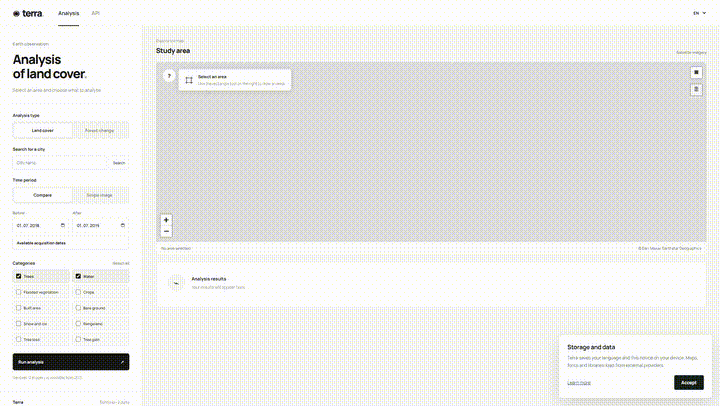

<div align="center">

# TERRA

### See how the land changes.

Satellite imagery, land-cover estimates and forest-change analysis in one map.

[Watch the demo](https://terra-observe-app.vercel.app/demo.html) · [API guide](docs/API.md) · [Interactive API](https://terra-observe-app.vercel.app/api/docs) · [Live demo](https://terra-observe-app.vercel.app/)

[](https://terra-observe-app.vercel.app/demo.html)

</div>

## The idea

Terra helps people explore changes across a selected area. Draw a rectangle, choose acquisition dates and categories, and compare estimates in hectares. View before, after and change overlays on the map, then export a PDF report, CSV, GeoJSON or GeoTIFF for further work.

The app has two analysis paths:

- **Land cover:** classifies Sentinel-2 L1C scenes with Blue Marble Landcover. It reports water, trees, flooded vegetation, crops, built area, bare ground, snow/ice and rangeland, plus changes in tree class.
- **Forest change:** runs the U-Net checkpoint from the supplied ML-Project on Landsat or Sentinel-2 scenes. It returns before/after images, a loss overlay, coverage and NDVI summaries.

The interface is English by default and includes a Russian language switch. The static site and Python API run in separate Vercel projects independently of your local computer; the site proxies API requests to the existing backend deployment. Free-tier quotas, cold starts, upstream imagery availability and platform uptime still apply.

## Important interpretation

These are estimates, not measurements of every individual tree. Sentinel-2 pixels represent roughly 10 × 10 m on the ground; a tree can share a pixel with buildings and may not be assigned to the tree class. “Not detected” does not mean “absent.” Water, roofs and other bright or dark urban surfaces can also be confused. Both class transitions and cloud masking can be wrong. Check results against independent, local ground truth before drawing conclusions.

The forest U-Net was trained in Japan and has **not** been independently validated worldwide. The Landsat path is experimental. Forest loss is a predicted transition, not proof of deforestation. Blue Marble land-cover results for 2010–2016 are unavailable: the coverage endpoint currently supports Sentinel-2 scenes from **2017 onward**. Requested dates are used to find a nearby suitable scene within 45 days; the response always includes the actual acquisition date. Availability, clouds, and external services can limit coverage. The annual land-cover API is a separate 2017–2023 product, not a dated observation.

## Demo

The [video demonstration](https://terra-observe-app.vercel.app/demo.html), edited with Remotion from a real screen recording, shows an earlier interface and the cursor: select an area and view forest-change imagery. The numerical example is an experimental estimate, not a certified measurement.

## Quick start

Requirements: Python 3.10 or newer, Node.js 18 or newer, and internet access. Model weights are downloaded on first inference. On a CPU, image analysis can take several minutes.

```bash
git clone https://github.com/Adis773/terra-earth-observation.git
cd terra-earth-observation
python -m venv .venv
# macOS / Linux: source .venv/bin/activate
# Windows PowerShell: .venv\Scripts\Activate.ps1
pip install -r backend/requirements.txt
cd backend
python -m uvicorn app:app --host 127.0.0.1 --port 60372
```

In a second terminal at the repository root:

```bash
node server.js
```

Open <http://localhost:3187> and select **Explore the map**. The FastAPI backend is served separately on port 60372. See the [API guide](docs/API.md) for requests and response examples.

### Docker

```bash
docker build -t terra .
docker run --rm -p 3187:3187 terra
```

The container serves the interface and proxies requests to its Python process. Persistent storage and high-availability infrastructure are not included.

## API at a glance

```bash
curl -X POST https://terra-observe-app.vercel.app/api/v2/cover \
  -H "Content-Type: application/json" \
  -d '{"bbox":[65.46,44.84,65.463,44.843],"before_date":"2023-07-09","after_date":"2026-07-01","categories":["trees","water"]}'
```

Coordinates are `[west, south, east, north]` in WGS84. For a single snapshot, omit `after_date`. The public API and [OpenAPI UI](https://terra-observe-app.vercel.app/api/docs) are hosted on Vercel. For production, add shared rate limits, authentication if appropriate, monitoring, persistent storage and independently validated models.

## Architecture

```text
Browser / Node.js proxy
        │
        ├── FastAPI ── Earth Search + public TiTiler ── Sentinel-2 L1C ── Blue Marble ONNX
        └── FastAPI ── Microsoft Planetary Computer ── Landsat / Sentinel-2 ── forest U-Net
```

Geodesic pixel-area calculations use WGS84. Valid data must overlap between the compared scenes. Coordinates are shared with remote providers when finding and cropping imagery. The first inference downloads model weights from Hugging Face. The interface uses portable inline data for class overlays, GeoTIFF and forest images, and generates PDF reports from the result payload so that downloads also work across serverless instances. Legacy URL-based exports are temporary.

## Testing

```bash
python -m unittest discover -s tests -v
```

Tests exercise class mapping, tree transitions and date validation. We also ran real-scene smoke tests for 2023 and 2026. This is not an independent accuracy assessment for every class or region.

## Team

- **Name:** _Add team member_
- **Name:** _Add team member_
- **Name:** _Add team member_

## Data and acknowledgements

- [Blue Marble Landcover](https://huggingface.co/Civimatica/blue-marble-landcover) — Sentinel-2 land-cover model.
- [Microsoft Planetary Computer](https://planetarycomputer.microsoft.com/) and [Earth Search](https://earth-search.aws.element84.com/) — satellite scene catalogs.
- Copernicus Sentinel data; Landsat data from USGS/NASA; satellite basemap from Esri and contributors; geocoding by OpenStreetMap Nominatim.
- The forest checkpoint and model architecture were supplied as the original ML-Project. See [its notes](backend/ORIGINAL_MODEL.md) for training and evaluation details.

This is a hackathon prototype. Review the licences and terms of external datasets, models, map tiles and services before redistribution or production use.
